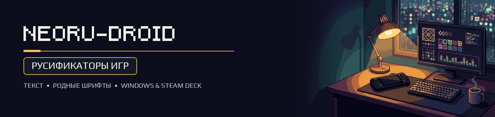

Русификаторы инди-игр и стратегий для **Windows** и **Steam Deck**: перевод текста, кириллица в родных шрифтах игры и установка в пару кликов с откатом оригинала.

### Готовые русификаторы

| Игра | Версия | Что внутри | Навигация |
| :--- | :---: | :--- | :--- |
| **Frontier Tale** | `v1.1` | Сюжет, диалоги, предметы, крафт, постройки и задания (под патч `2.1.0`) | [Скачать v1.1](https://github.com/neoru-droid/frontier-tale-ru/releases/latest) · [Все версии](https://github.com/neoru-droid/frontier-tale-ru/releases) · [Описание](https://github.com/neoru-droid/frontier-tale-ru) · [Steam](https://steamcommunity.com/sharedfiles/filedetails/?id=3840837132) |
| **Zombies Aren't Real** | `v1.1` | Исправленный текст взамен машинного, пиксельный шрифт 8x8 и Tactical HUD (под патч `v0.43.1`) | [Скачать v1.1](https://github.com/neoru-droid/zombies-arent-real-ru/releases/latest) · [Все версии](https://github.com/neoru-droid/zombies-arent-real-ru/releases) · [Описание](https://github.com/neoru-droid/zombies-arent-real-ru) · [Steam](https://steamcommunity.com/sharedfiles/filedetails/?id=3840725363) |
| **We March as One** | `v1.1` | Кампания на 50 уровней, все режимы, 5 родных шрифтов и экран 30 достижений в меню игры | [Скачать v1.1](https://github.com/neoru-droid/we-march-as-one-ru/releases/latest) · [Все версии](https://github.com/neoru-droid/we-march-as-one-ru/releases) · [Описание](https://github.com/neoru-droid/we-march-as-one-ru) · [Steam](https://steamcommunity.com/sharedfiles/filedetails/?id=3840161059) |

### Ссылки и поддержка

- **[Страница на Boosty](https://boosty.to/cd_tixo)** - лента всех релизов, обновления под патчи и выбор следующих игр на перевод
- **[Разовые чаевые через CloudTips](https://pay.cloudtips.ru/p/240b8760)** (СБП / карта)
