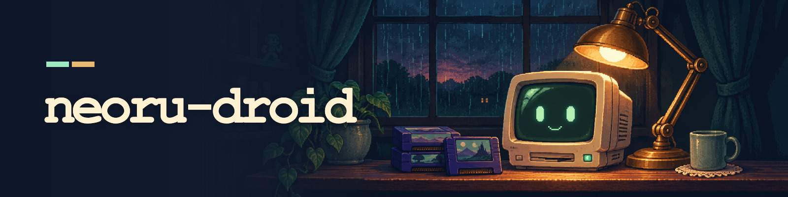

<picture>
  <source media="(max-width: 600px)" srcset="media/header-mobile.jpg">
  
</picture>

# Русификаторы игр

Бесплатные переводы инди-игр и стратегий. В каждом выпуске есть установщик и возможность вернуть оригинал.

### Frontier Tale

Сюжет, диалоги, предметы, рецепты и задания на русском языке. Проверено на Frontier Tale 2.1.5 (сборка Steam 26751033).

**[Скачать v1.2 (ZIP)](https://github.com/neoru-droid/frontier-tale-ru/releases/download/v1.2.0/FrontierTale-RU-v1.2.zip)** · [Как установить](https://github.com/neoru-droid/frontier-tale-ru#установка)

### We March as One

Кампания на 50 уровней, пять игровых шрифтов с кириллицей и экран 30 достижений. Проверенная сборка Steam: 26651298.

**[Скачать v1.2 (ZIP)](https://github.com/neoru-droid/we-march-as-one-ru/releases/download/v1.2.0/WeMarchAsOne-RU-v1.2.zip)** · [Как установить](https://github.com/neoru-droid/we-march-as-one-ru#установка)

### Zombies Aren’t Real

Исправленный русский текст, пиксельный шрифт 8×8 и гладкий Tactical HUD в настройках экрана. Проверено на патче 0.43.1 (сборка Steam 26692741).

**[Скачать v1.2 (ZIP)](https://github.com/neoru-droid/zombies-arent-real-ru/releases/download/v1.2.0/ZombiesArentReal-RU-v1.2.zip)** · [Как установить](https://github.com/neoru-droid/zombies-arent-real-ru#установка)

### Поддержать переводы

[Новости и выбор следующей игры на Boosty](https://boosty.to/cd_tixo) · [Разовые чаевые](https://pay.cloudtips.ru/p/240b8760)
